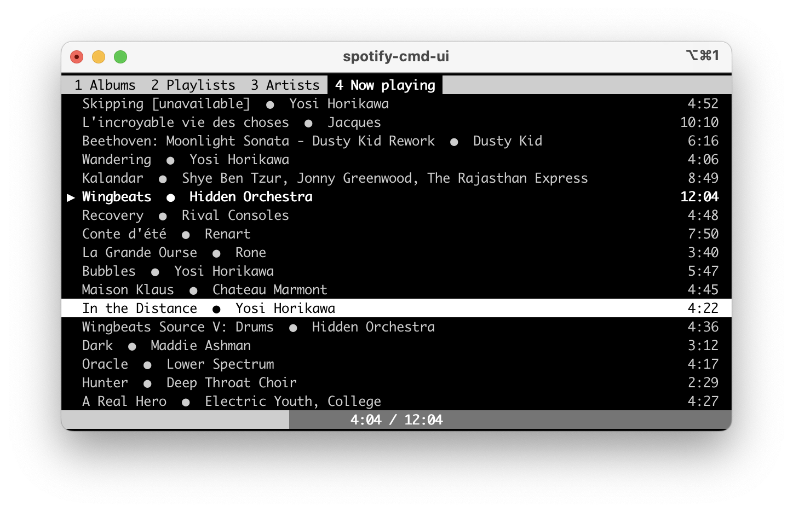

# 📻 spotify-cmd v0.9.11

`spotify-cmd` is a Spotify client that allows controlling the playback of **albums, playlists, and followed artists** from a user's library (based on names or Spotify URIs) and individual tracks (based solely on Spotify URIs). The application is intended for use with [spotifyd](https://github.com/Spotifyd/spotifyd), but it works with any Spotify-enabled device.

## Installation

Ensure you have Python 3 installed. Package is available on PyPi: https://pypi.org/project/spotify-cmd/. Install it using `pip3`:

```bash
pip3 install spotify-cmd
```

On first use, the CLI, terminal UI, or daemon creates a private configuration
template and prints setup instructions. You can also prepare it explicitly:

```bash
spotify-cmd init
# Edit the file printed by init; fill in client_id and client_secret.
spotify-cmd config check
spotify-cmd auth
spotify-cmd-daemon
spotify-cmd-ui
```

Create an app in the [Spotify Developer Dashboard](https://developer.spotify.com/dashboard)
and register `http://127.0.0.1:8888/callback` as its redirect URI.
Spotify requires an explicit loopback IP rather than `localhost`
([redirect URI requirements](https://developer.spotify.com/documentation/web-api/concepts/redirect_uri)).
For a headless host, use `spotify-cmd auth --no-browser` and paste the full
redirect URL when prompted. The browser may show a connection error when the
callback is on another machine; copy its URL to the terminal on the host.

`init` never overwrites an existing file. Newly created configuration files
have permissions `0600`. `config check` validates local settings without
contacting Spotify or printing credentials. Authorization stores the token
in `cache/token-cache` next to the configuration. Restart the daemon after
editing its settings. Help and version commands do not create configuration.

### Debian/Ubuntu (apt)

```bash
curl -fsSL https://maciej-ciemborowicz.eu/apt/spotify-cmd.gpg | sudo gpg --dearmor -o /usr/share/keyrings/spotify-cmd-archive-keyring.gpg
echo "deb [signed-by=/usr/share/keyrings/spotify-cmd-archive-keyring.gpg] https://maciej-ciemborowicz.eu/apt ./" | sudo tee /etc/apt/sources.list.d/spotify-cmd.list
sudo apt update
sudo apt install spotify-cmd
```

The apt installer creates a service configuration template at
`/var/lib/spotify-cmd/.config/spotify-cmd/config.ini` without overwriting an
existing file. Fill in the Spotify credentials, then authorize as the service
user so the daemon can read its token:

```bash
sudo -u spotify-cmd spotify-cmd config check
sudo -u spotify-cmd spotify-cmd auth --no-browser
sudo systemctl restart spotify-cmd
sudo systemctl status spotify-cmd --no-pager
```

The systemd service skips startup while configuration is incomplete.
The CLI and TUI only need the socket settings; they do not need access to the
service user's credentials. For a separate client configuration, run
`spotify-cmd init` as your user and set `socket_path = /run/spotify-cmd/spotify-cmd.sock`.

If you want to run the client as a regular user (for example `pi`), add it to the `spotify-cmd` group so it can access the daemon socket:

```bash
sudo usermod -aG spotify-cmd <user>
```

### Headless spotifyd (Raspberry Pi, servers)

When using spotifyd on headless hosts, run it in the foreground under systemd and disable MPRIS to avoid DBus/X11 issues:

```ini
[global]
use_mpris = false
```

## Native background services

The daemon can be managed by systemd on Linux or launchd on macOS. Complete
`spotify-cmd config check` and `spotify-cmd auth` as the account running the
service before enabling it. Use `auth --no-browser` on a headless host.
Services cannot complete interactive authorization themselves.

Stop any manually started daemon before switching to a service. If it runs
in the foreground, use Ctrl+C; for a detached process, inspect
`ps -ax -o pid,command` and send `kill -TERM <pid>` to the matching daemon.
`spotify-cmd stop` stops music playback, not the daemon process.
Run only one daemon: the current implementation uses a shared PID lock.

The templates below are in this repository's `contrib/` directory. Run the
copy commands from a checkout, or download the linked template first.
Use `command -v spotify-cmd` and `command -v spotify-cmd-daemon` to locate
your installation. Service managers do not load your shell's PATH or aliases.
Keep CLI/TUI and daemon configured to use the same socket.

### Linux: systemd user service (pip/pipx)

Copy the [user unit](contrib/systemd/spotify-cmd.service):

```bash
mkdir -p ~/.config/systemd/user
cp contrib/systemd/spotify-cmd.service ~/.config/systemd/user/
```

Edit the copied file if your executables are not in `~/.local/bin`.
`%h` expands to your home directory; use absolute paths for other locations.
Also adjust `SPOTIFY_CMD_CONFIG` if using a non-default configuration file.
New user configurations already specify a writable `/tmp/spotify-cmd-<uid>.sock`;
older configurations pointing to the system service's `/run/spotify-cmd`
directory need a writable user socket path.

```bash
systemctl --user daemon-reload
systemctl --user enable --now spotify-cmd.service
systemctl --user status spotify-cmd.service
systemctl --user restart spotify-cmd.service
journalctl --user -u spotify-cmd.service -f
```

This enables startup with your user manager (normally at login). To keep the
user manager running after logout, an administrator can enable lingering with
`sudo loginctl enable-linger YOUR_USER`. For temporary shutdown use
`systemctl --user stop spotify-cmd.service`. To stop and disable autostart:

```bash
systemctl --user disable --now spotify-cmd.service
```

After editing the unit, run `daemon-reload` and restart it. If repeated startup
failures hit the restart limit, fix the cause shown in the journal, then run
`systemctl --user reset-failed spotify-cmd.service` before starting again.

### Linux: system service (apt)

The apt package already installs the [system unit](debian/spotify-cmd.service).
Use it instead of installing the user unit:

```bash
sudo systemctl enable --now spotify-cmd.service
sudo systemctl restart spotify-cmd.service
sudo systemctl status spotify-cmd.service
sudo journalctl -u spotify-cmd.service -f
# Stop and disable startup at boot:
sudo systemctl disable --now spotify-cmd.service
```

### macOS: launchd user agent

Copy the [LaunchAgent](contrib/launchd/com.spotify-cmd.daemon.plist):

```bash
mkdir -p ~/Library/LaunchAgents ~/Library/Logs
cp contrib/launchd/com.spotify-cmd.daemon.plist ~/Library/LaunchAgents/
```

Edit the copied plist: replace every `/Users/YOUR_USER` with your actual home
directory and set the first `ProgramArguments` entry to the absolute path of
`spotify-cmd-daemon`. Adjust the configuration path if necessary. launchd does
not expand `~`, `$HOME`, or shell commands inside plist values.

```bash
plutil -lint ~/Library/LaunchAgents/com.spotify-cmd.daemon.plist
launchctl bootstrap "gui/$(id -u)" ~/Library/LaunchAgents/com.spotify-cmd.daemon.plist
launchctl print "gui/$(id -u)/com.spotify-cmd.daemon"
# Restart:
launchctl kickstart -k "gui/$(id -u)/com.spotify-cmd.daemon"
# Logs (default template paths):
tail -f ~/Library/Logs/spotify-cmd.stdout.log ~/Library/Logs/spotify-cmd.stderr.log
```

The agent starts at login and restarts after failure. To stop it for the current
session, run:

```bash
launchctl bootout "gui/$(id -u)" ~/Library/LaunchAgents/com.spotify-cmd.daemon.plist
```

To disable future autostart, also move the plist out of `~/Library/LaunchAgents`.
After editing the plist, use `bootout` followed by `bootstrap` to load the new
settings. These commands run as your logged-in user, without `sudo`.

Both templates run the daemon with `--foreground` so the system service manager
supervises it directly. See the native documentation for
[systemd services](https://www.freedesktop.org/software/systemd/man/latest/systemd.service.html)
and [launchd agents](https://developer.apple.com/library/archive/documentation/MacOSX/Conceptual/BPSystemStartup/Chapters/CreatingLaunchdJobs.html).

## Configuration

User configuration is created at `~/.config/spotify-cmd/config.ini`.
Set `SPOTIFY_CMD_CONFIG` to select an explicit file (also used by `init`);
an explicit missing file never falls back to another configuration.
Otherwise the search order is the user file, the apt service file, then
`/etc/spotify-cmd/config.ini`. Below is an example for the apt service:

```ini
[SPOTIFY]
client_id = your_client_id
client_secret = your_client_secret
# Optional; omit to use the active device:
# device_name = your_device_name
redirect_uri = http://127.0.0.1:8888/callback

[SPOTIFY_CMD_DAEMON]
socket_path = /run/spotify-cmd/spotify-cmd.sock
socket_buffer_size = 1024
```

* **client_id**, **client_secret** are required. Obtain these by creating an app at the [Spotify Developer Dashboard](https://developer.spotify.com/dashboard/applications).
* **device_name** is optional. If set, `spotify-cmd-daemon` will force to use it even if another is active; if omitted, it uses the current active device.
* **redirect_uri** is used for Spotify authentication. If not set, it defaults to 'http://127.0.0.1:8888/callback'. Existing explicit values are preserved; update both the file and Spotify app settings if migrating from localhost.
* **socket_path** specifies the Unix socket path for the daemon. Defaults to '/run/spotify-cmd/spotify-cmd.sock' on Linux and '/tmp/spotify-cmd-daemon.sock' on other systems.
* **socket_buffer_size** defines the buffer size for socket communication. Defaults to 1024.

New user templates explicitly use `/tmp/spotify-cmd-<uid>.sock`, writable
without systemd on Linux and macOS. Service templates use
`/run/spotify-cmd/spotify-cmd.sock`. Existing socket settings are preserved;
CLI and daemon must use the same socket path.

## Playback device

`spotify-cmd` controls a Spotify Connect device; it does not play audio itself. Choose one of these options.

### Option 1: spotifyd

Run [spotifyd](https://github.com/Spotifyd/spotifyd) on the machine that should play music, then set its Spotify Connect device name in `config.ini`:

```ini
[SPOTIFY]
device_name = My spotifyd
```

This is the suitable option for headless machines and dedicated audio devices. For a headless systemd service, see the spotifyd instructions above.

### Option 2: Official Spotify app

Open the official Spotify desktop, mobile, or web app and make it the active playback device in Spotify Connect. Leave `device_name` unset to let `spotify-cmd` use the active device, or set it to the exact name displayed by the Spotify app:

```ini
[SPOTIFY]
device_name = MacBook Pro
```

The official app must be open and visible as a Spotify Connect device before sending a playback command. If another device is active, selecting `device_name` makes `spotify-cmd` transfer playback to that named device.

## Commands

`spotify-cmd` offers the following commands:

* `get playlists`: Lists the user's playlists.
* `get albums`: Lists the user's albums.
* `get artists`: Lists the user's followed artists.
* `play playlist <name>`, `play album <name>`, `play artist <name>`, `play uri <spotify_uri>`: Plays a specific playlist, album, followed artist, or resource by Spotify URI.
* `play`, `pause`, `next`, `previous`: Controls playback.
* `set shuffle <on|off>`: Toggles shuffle mode.
* `set volume <0-100>`: Sets the volume level.
* `find <search_type> <query>`: Searches for items on Spotify. Acceptable search types are `album`, `artist`, `playlist`, `track`, `episode`, and `show`.
* `version`: Prints the installed `spotify-cmd` version.

## Output Format

Select output format using the `--format` flag:

* `--format text`: Plain text output (default).
* `--format json`: Output in JSON format.
* `--format verbose`: Verbose text information.

## Usage Examples

``` bash
spotify-cmd get albums
spotify-cmd get playlists
spotify-cmd get artists
spotify-cmd play album "Listening Tree"
spotify-cmd play artist "Nils Frahm"
spotify-cmd play uri spotify:album:5zKTfU3vyuZfLgtYRfJyza
spotify-cmd find artist "Nils Frahm"
```

## Terminal UI



Run `spotify-cmd-ui` to browse albums, playlists, followed artists, and the active Spotify queue. Use `1`, `2`, `3`, and `4` to change views, arrow keys to select an item, and Enter to play it. In Artists, Enter opens the selected artist’s albums (including EPs and singles); Enter on an album starts playback. Left returns from the album list to artists. Selecting the Artists tab always opens the artist list. Left/right seek during playback. Unavailable tracks are skipped when selecting a track for playback. Space toggles play/pause, `s` stops playback, and `h` toggles shuffle. The UI receives state events from the daemon, so changes made through any client appear automatically.

## For Developers

Developers can create interfaces for `spotify-cmd-daemon` using `/run/spotify-cmd/spotify-cmd.sock` (Linux) or `/tmp/spotify-cmd-daemon.sock` (other systems). Socket handling and data format details are in the `./src/common` directory (there is no documentation).

### Test coverage

Install development dependencies and enable the Git hook:

```bash
pip install -e '.[dev]'
pre-commit install
```

Every commit runs the test suite with coverage for `src`. A commit passes only with 100% coverage. Run the same check manually with:

```bash
python -m coverage run -m pytest
python -m coverage report
```

The published-package smoke test uses PyPI and a new virtual environment. Run it explicitly when validating a release:

```bash
python -m pytest -m pypi
```

Daemon helper:

* `spotify-cmd-daemon --version` prints the installed daemon version.

## Planned Features and Upcoming Development

* ~~Displaying tracks from specific albums or playlists.~~ [Done in 0.1.22]
* ~~MPRIS D-Bus interface support to reduce server queries.~~ [Done in 0.1.22]
* ~~`spotify-cmd-ui`: A ncurses-based UI for track display and control, working with the same daemon.~~ [Done in 0.1.22]
* ~~Search functionality.~~ [Done in 0.1.4]
* ~~Support for other resource types like artists.~~ [Done]
* ~~Config instructions after installation / creation of default config.~~ [Done]

## License

This project is licensed under the terms of the GNU General Public License. Detailed information can be found in the [LICENSE.md](LICENSE.md) file.

## Author

Project created by Maciej Ciemborowicz.
